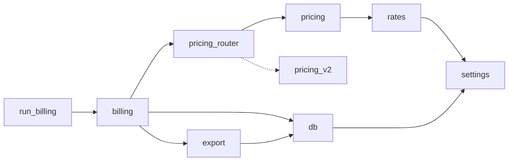

# ShipBill Architecture Notes

These notes began in Demo 1, when Copilot drafted them from the source code and a person checked every rule against the line it cites. They were updated after Demo 3 moved per-shipment pricing into its own module and upgraded arrow. They describe what the code does today, not what anyone intended.

## Purpose

ShipBill produces the monthly invoices for a regional courier. For a billing period it prices every shipment, applies discounts, fuel, minimum charges and sales tax, stores the invoices in SQLite, and writes a fixed-width file that accounting imports into LedgerLink. If that file is wrong or late, invoices don't go out.

## How a Billing Run Works

1. `run_billing.py` `main` reads the period (`YYYY-MM`) from the command line and makes sure the database exists.
2. `shipbill/billing.py` `run_billing` deletes any invoices already stored for the period, so a rerun starts clean.
3. `shipbill/db.py` `get_active_customers` finds active customers with at least one shipment in the period.
4. `shipbill/billing.py` `calc_invoice` asks `shipbill/pricing_router.py` to price each shipment, then adds discounts, fuel, minimum charge and tax, and saves the invoice and its lines.
5. `shipbill/pricing_router.py` `price_shipment` hands each shipment to the legacy `shipbill/pricing.py` or, for services listed in `ROUTED_TO_V2`, to the new `shipbill/pricing_v2.py`.
6. `shipbill/export.py` `write_ledger_file` writes `out/LEDGER_YYYYMM.TXT` with a header, one record per invoice, and a trailer.

## Module Map

| Module | Responsible for | Depends on |
|--------|-----------------|------------|
| `run_billing.py` | Command-line entry point and the invoice printout | billing, db, settings, util |
| `shipbill/billing.py` | Discounts, fuel, minimum charge, tax, saving invoices, the run itself | dates, db, export, pricing_router, settings, util |
| `shipbill/pricing_router.py` | Choosing the pricing engine for each shipment | pricing, pricing_v2 |
| `shipbill/pricing.py` | The legacy per-shipment pricing, extracted in Demo 3 | dates, rates, settings, util |
| `shipbill/rates.py` | Zones, chargeable weight, base charges | settings |
| `shipbill/dates.py` | Parsing and formatting dates, due dates, the batch stamp | arrow (1.4.0) |
| `shipbill/db.py` | The shared SQLite connection and every query | settings |
| `shipbill/export.py` | The LedgerLink file | dates, db, settings, util |
| `shipbill/util.py` | Rounding and money formatting | nothing |
| `shipbill/settings.py` | Rates, zones, fuel table, fees, paths | nothing |
| `shipbill/notify.py` | Faxing invoices (nothing calls it) | db, util |

## Business Rules

The code applies these in this order, and the order matters.

| # | Rule | Where | Driven by |
|---|------|-------|-----------|
| 1 | Cancelled shipments aren't billed. | `shipbill/pricing.py:17` | `status == "CANCELLED"` |
| 2 | Four-digit zips get their leading zero back before zoning. | `shipbill/rates.py:10` | `zfill(5)` |
| 3 | The zone comes from the first digit of the zip. Anything that isn't all digits is priced as zone 5 plus a remote fee. | `shipbill/rates.py:6`, `shipbill/pricing.py:23` | `ZONES`, `REMOTE_FEE` = 7.50 |
| 4 | Chargeable weight is the larger of actual and volumetric weight (cm³ / 5000), rounded up to the next half kilo. | `shipbill/rates.py:16` | `VOL_DIVISOR` = 5000 |
| 5 | The base price covers the first kilo, and each extra kilo costs the per-kg rate. | `shipbill/rates.py:25` | `RATES` |
| 6 | Unknown service codes, such as `OVN`, are priced as `STD`. | `shipbill/pricing.py:28` | `KeyError` fallback |
| 7 | Returns are billed at half price, with no weekend fee. | `shipbill/pricing.py:31` | `RETURN_RATE` = 0.5 |
| 8 | Each shipment line is rounded half up with `round2`, which works on floats. | `shipbill/pricing.py:36`, `shipbill/util.py:1` | `int(x * 100 + 0.5) / 100.0` |
| 9 | Express shipments picked up on a Saturday add a weekend fee. | `shipbill/pricing.py:39` | `WEEKEND_FEE` = 12.00 |
| 10 | Customer 1047 gets 15% off. Other key accounts get 10%. | `shipbill/billing.py:35` | Hard-coded id, `KEY_ACCOUNT_DISCOUNT` |
| 11 | Fuel is charged on transport after the discount. A month that's missing from the table uses the latest earlier month. | `shipbill/billing.py:4`, `shipbill/billing.py:45` | `FUEL_TABLE` |
| 12 | Invoices under $25.00 of transport after discount are topped up with a minimum charge line. Fuel doesn't count toward it. | `shipbill/billing.py:49` | `MIN_CHARGE` = 25.00 |
| 13 | Sales tax is charged on transport plus any minimum charge, never on fuel. Tax-exempt customers pay none. | `shipbill/billing.py:55` | `TAX_RATE` = 0.0825 |
| 14 | The invoice is dated the last day of the period and due 30 days later, moved to Monday if that's a weekend. | `shipbill/dates.py:15`, `shipbill/dates.py:19` | arrow `shift` |
| 15 | Customers marked inactive aren't billed, even when they shipped. | `shipbill/db.py:46` | `c.active = 1` |

## Implicit Constraints

- **The LedgerLink file format.** Accounting's import expects 80-character records, CRLF line endings, amounts in zero-padded cents, names upper-cased and cut to 20 characters, and a trailer whose hash total is the sum of the invoice totals in cents (`shipbill/export.py`). A change to any byte can fail the import.
- **Past invoices.** Customers already have invoices calculated with these exact rules, including the float rounding. A change that moves any total by a cent will show up as a discrepancy when someone compares months. **(inferred)**
- **Dates stored as text.** Shipment and invoice dates are `MM/DD/YYYY` strings, and periods are matched with `LIKE` patterns (`shipbill/db.py:40`). Anything that writes dates in another format will silently drop shipments from billing.
- **The fuel table is maintained by hand.** September 2026 isn't in `FUEL_TABLE`, so it's billed at August's rate (`shipbill/settings.py:29`).

## Tech Debt and Risks

- `calc_invoice` still applies discounts, fuel, minimum charge and tax and saves the result in one function. Pricing moved out in Demo 3.
- One global connection, `db.CONN`, that every module shares (`shipbill/db.py:5`). Tests have to reset it.
- SQL built by joining strings in `shipbill/db.py`.
- Money is held in floats, so an amount that should end in exactly half a cent often lands a hair below it, and `round2` rounds it down. An `ECO` parcel to zone 4 at 9.5 kg works out to 15.024999… and bills as 15.02, where exact arithmetic would give 15.03.
- Dead code: `notify.send_fax` and `billing.recalc_all` aren't called from anywhere.
- `README.txt` is out of date: it describes Python 2.7, command-line options that don't exist, and an Access database.

## Open Questions

- **Accounting:** Is customer 1047's 15% discount still in their contract, and does it end?
- **Accounting:** Should fuel really be excluded from the minimum charge and from sales tax?
- **Operations:** What is the September 2026 fuel rate? Should a missing month stop the run instead of reusing the last rate?
- **Operations:** Customer 1084 is inactive but shipped in September. Should those shipments be billed?
- **Operations:** Is `OVN` still a service we sell? If so, should it really be priced as `STD`?
- **Accounting:** Is the float rounding in `round2` the rounding accounting expects, or would they accept true half-up rounding?
- **IT:** Does anything still use the fax gateway in `notify.py`?
- **Operations:** A ZIP+4 such as `30301-1234` isn't all digits, so it's billed as remote. Is that what customers expect? (Found while writing the characterization tests.)
- **Accounting:** On an invoice with a minimum charge, the stored `subtotal` leaves the minimum charge out but `total` includes it. Does anything downstream read `subtotal`? (Found while writing the characterization tests.)
